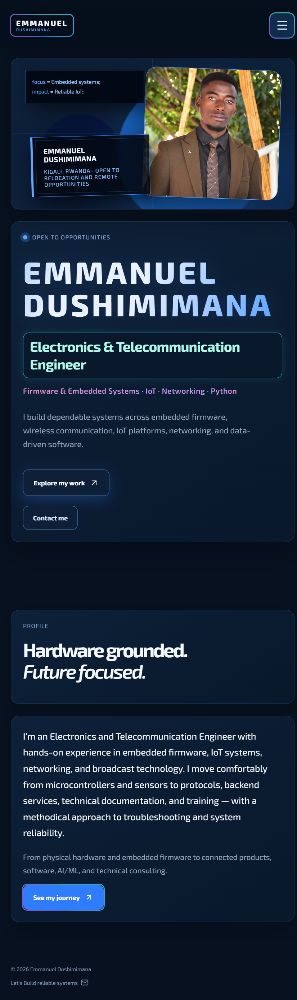
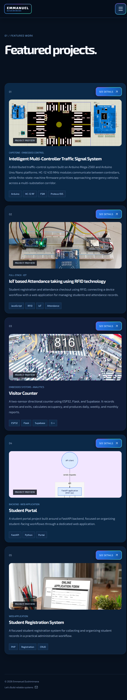
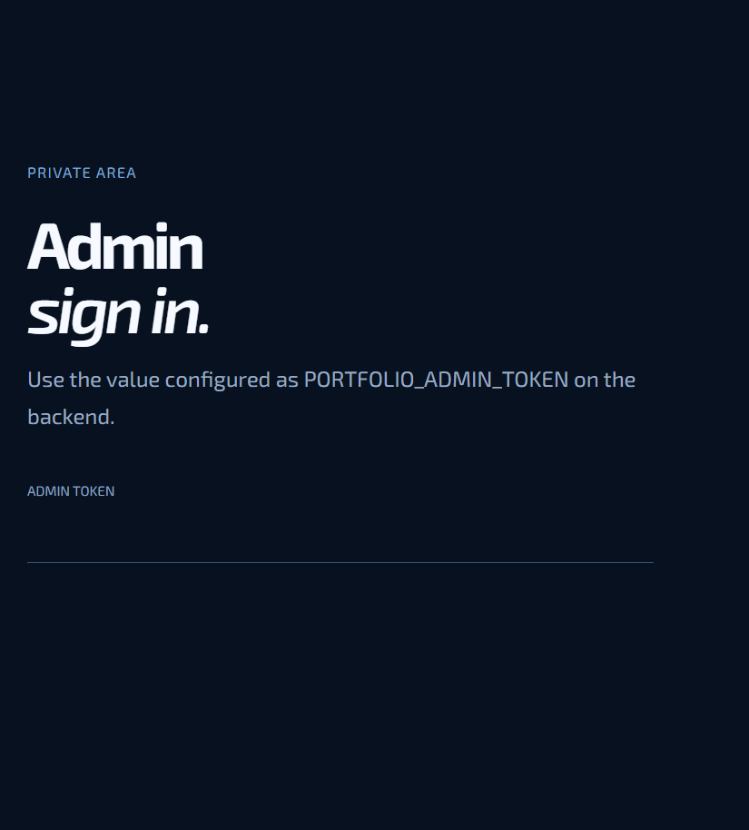

# Emmanuel Dushimimana — Portfolio

A React/Vite portfolio backed by a FastAPI API and Supabase. Public pages read
portfolio content from the database; content is managed through the protected
admin dashboard.

## Project structure

```text
frontend/       React app, Vite config, and static assets
backend/        FastAPI application, tests, and pinned dependencies
supabase/       Database schema and intentionally empty seed file
docs/           Architecture overview
```

See [`docs/architecture.md`](./docs/architecture.md) for the request and data-flow diagram.

## Screenshots

| Home | Projects | Admin sign-in |
|---|---|---|
|  |  |  |

## Requirements

- Node.js 22 or newer and npm
- Python 3.12 or newer
- A Supabase project

## Local setup

Copy `backend/.env.example` to `backend/.env` and fill in your private Supabase
credentials, admin token, and (optionally) SMTP settings. Copy
`frontend/.env.example` to `frontend/.env` if the API is hosted separately;
`VITE_API_URL` should be the API origin without a trailing slash. Leave it empty
for local development, where Vite proxies `/api` to FastAPI.

Run the Supabase schema from [`supabase/schema.sql`](./supabase/schema.sql) in
the Supabase SQL Editor before starting the API. The SQL file creates tables,
policies, and storage configuration but does not insert portfolio content.
[`supabase/seed.sql`](./supabase/seed.sql) is intentionally empty of data.
Create the profile and portfolio records through the admin dashboard.

Start the backend in one terminal:

```powershell
cd backend
python -m venv ..\.venv
..\.venv\Scripts\python.exe -m pip install -r requirements.txt
..\.venv\Scripts\python.exe -m uvicorn app.main:app --reload --port 8000
```

Start the frontend in another terminal:

```powershell
cd frontend
npm ci
npm run dev
```

Open `http://localhost:5173`. The admin dashboard is at
`http://localhost:5173/#admin`; sign in with `PORTFOLIO_ADMIN_TOKEN`.

## Configuration

Backend variables are documented in [`backend/.env.example`](./backend/.env.example).
The Supabase service-role key must remain server-side and must never be placed in
the frontend environment. Contact notifications require the SMTP variables; if
SMTP is unavailable, submitted messages remain accessible in the admin Contacts
section.

## Portfolio and media management

The admin dashboard manages the profile, experiences, projects, education,
skills, certifications, languages, and contact messages. Experience entries can
include an optional achievement summary, a company logo, and up to four gallery
images. Logos display beside the company name on the experience list and detail
page; absent logos do not reserve space. Uploaded media is stored in the public
`portfolio-media` Supabase Storage bucket, with a 5 MB per-image limit.

The public contact form clears on submission and shows success or explanatory
error feedback for ten seconds. Successful submissions are saved to Supabase;
email notifications are sent when SMTP is configured.

## Quality checks

From `frontend/`:

```powershell
npm run lint
npm test
npm run build
```

From `backend/`:

```powershell
..\.venv\Scripts\python.exe -m pip install -r requirements-dev.txt
..\.venv\Scripts\ruff.exe check app tests
..\.venv\Scripts\python.exe -m pytest
```

GitHub Actions runs the frontend lint, test, and production build checks and the
backend Ruff and pytest checks on pushes and pull requests.

## License

Released under the [MIT License](./LICENSE).
