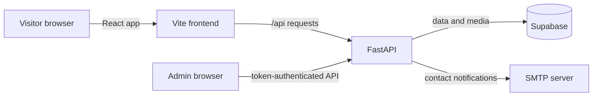

# Architecture

The frontend is a static React application. In development, Vite proxies `/api`
to FastAPI; deployments can set `VITE_API_URL` to the API origin. FastAPI uses
the Supabase service-role key only on the server, authenticates administrative
routes with `PORTFOLIO_ADMIN_TOKEN`, and optionally sends contact notifications
using SMTP. Portfolio records are managed through the admin UI; SQL schema
installation does not populate portfolio content.
